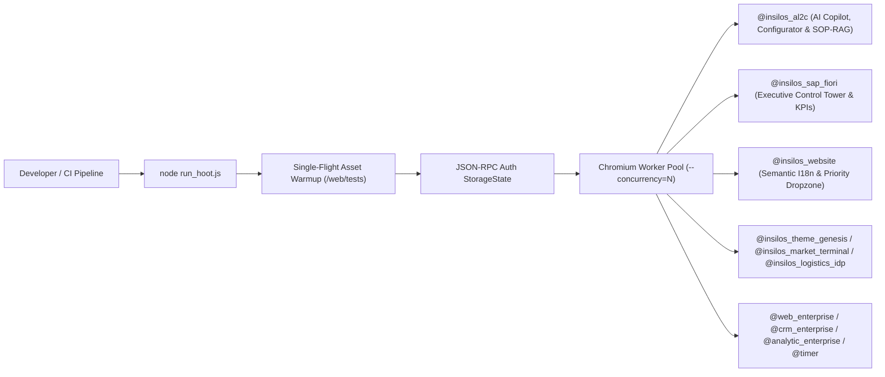

# E2E Test Infra & Parallel HOOT Harness (`run_hoot.js`)

## 1. Architecture Overview

The Insilos Enterprise Odoo 20 platform enforces a multi-layer automated verification harness combining:
1. **Parallel Headless HOOT Test Runner ([`run_hoot.js`](file:///home/zen/O20/run_hoot.js))**: High-throughput Chromium worker pool testing OWL 2 / OWL 3 (`@insilos/owl`) components across both **Desktop (`1366×768`)** and **Mobile (`375×667`)** viewports with single-flight asset compilation warmup and secret-redacted logging (`redactSensitive`).
2. **Backend & Security Governance Suites (`tools/test_*.py`)**: Deterministic verification of AL2C Lead-to-Cash, Grounded SOP-RAG, statutory VN 2026 payroll, ISO/IEC 27701 PII masking, and dual-bundle SCSS integrity.



---

## 2. HOOT Suite Inventory & Coverage Matrix

| Suite (`@addon_name`) | Test File | Scope & Key Assertions | Desktop | Mobile | Status |
|---|---|---|---|---|---|
| `@insilos_al2c` | [`al2c_ai_copilot_sop_rag.test.js`](file:///home/zen/O20/addons/insilos_al2c/static/tests/al2c_ai_copilot_sop_rag.test.js) | `AiConciergeWidget` 6 Software Engineering Services catalog (`sw_squad` TT 13/2020/TT-BTTTT, `sw_turnkey`, `erp` 1C26TAA, `grc` ISO 27701/NĐ 13/2023, `ai`, `zencode`), deterministic & RPC configurator estimation, SOP-RAG grounded chat with KMS citations & entailment score, WAF strike/cooldown lockout, honeypot + arithmetic challenge + Fast-Track Priority RFP attachment, Phosphor Duotone icon resolution | 8 / 8 | 8 / 8 | PASS |
| `@insilos_sap_fiori` | [`sap_fiori.test.js`](file:///home/zen/O20/addons/insilos_sap_fiori/static/tests/sap_fiori.test.js) | `ExecutiveControlTower`, `KPISummaryTile`, `TimeframeFilterBar`, `sanitizeId` prototype-pollution guard (`__proto__`, `constructor`), SVG sparkline coordinate calculation, timeframe & domain ORM reload | 6 / 6 | 6 / 6 | PASS |
| `@insilos_website` | [`innoria_website.test.js`](file:///home/zen/O20/enterprise/insilos_website/static/tests/innoria_website.test.js) | `InnoriaI18nEngine` semantic phrase dictionary (`Đăng nhập` $\leftrightarrow$ `Sign in`, `Liên hệ` $\leftrightarrow$ `Contact us`), bi-directional `data-i18n-*` & block translation preserving Phosphor Duotone SVGs, Priority File Dropzone SLA badge activation | 5 / 5 | 5 / 5 | PASS |
| `@insilos_theme_genesis` | [`theme_genesis.test.js`](file:///home/zen/O20/enterprise/insilos_theme_genesis/static/tests/theme_genesis.test.js) | `FloatingBatchActionBar` multi-record batch actions, permission gates, `UserMenu` customization, `ErrorDialog` telemetry & PII/secret sanitization | 7 / 7 | 7 / 7 | PASS |
| `@insilos_market_terminal` | [`terminal.test.js`](file:///home/zen/O20/enterprise/insilos_market_terminal/static/tests/terminal.test.js) | `MarketTerminalAction` OHLC candlestick integrity, separate volume scale, governed drill-through overlays, `LatencyTracker` p50/p95 SLA | 5 / 5 | 5 / 5 | PASS |
| `@insilos_logistics_idp` | [`dashboard.test.js`](file:///home/zen/O20/enterprise/insilos_logistics_idp/static/tests/dashboard.test.js), [`document_form.test.js`](file:///home/zen/O20/enterprise/insilos_logistics_idp/static/tests/document_form.test.js) | Logistics IDP extraction dashboard, confidence badges, document split-view form controller | 17 / 17 | 16 / 16 | PASS |
| `@web_enterprise` | [`webclient_enterprise.test.js`](file:///home/zen/O20/enterprise/web_enterprise/static/tests/webclient/webclient_enterprise.test.js), [`home_menu.test.js`](file:///home/zen/O20/enterprise/web_enterprise/static/tests/webclient/home_menu.test.js) | Enterprise WebClient, `HomeMenu` Employee Self-Service Hub, `color_scheme_service` light/dark switching, mobile action manager & pivot view | 60 / 60 | 41 / 41 | PASS |
| `@crm_enterprise`, `@analytic_enterprise`, `@timer` | Enterprise view suites | Cohort, map, gantt, grid, timer reactive hooks | 6 / 6 | 5 / 5 | PASS |

---

## 3. Running HOOT Tests (`run_hoot.js`)

### Run All Core `insilos_*` & Enterprise Suites
```bash
node run_hoot.js insilos_al2c insilos_sap_fiori insilos_website insilos_theme_genesis insilos_market_terminal insilos_logistics_idp web_enterprise crm_enterprise analytic_enterprise timer --no-warmup --concurrency=3
```

### Run Specific Module Suites
```bash
node run_hoot.js insilos_al2c insilos_sap_fiori insilos_website --no-warmup --concurrency=2
```

### Registering New HOOT Test Files (`web.assets_unit_tests`)
When adding a new `static/tests/*.test.js` file to any addon:
1. Declare the test glob (and any frontend-only JS/XML dependencies not already in `web.assets_backend`) under `'assets': {'web.assets_unit_tests': [...]}` in `__manifest__.py`.
2. Ensure matching rows exist in PostgreSQL `ir_asset` (`bundle = 'web.assets_unit_tests'`, `active = TRUE`).
3. Purge cached unit test bundles (`DELETE FROM ir_attachment WHERE name LIKE '%web.assets_unit_tests%';`) and send `SIGHUP` (`kill -HUP <pid>`) to the running `odoo-bin` process so `Manifest._cached_manifests` and `api.ormcache(cache='assets')` reload cleanly.

---

## 4. Pre-Push Python & Playwright Verification Commands
```bash
python3 tools/test_adversarial_security.py && \
python3 tools/test_dgm_hr_payroll_dashboard.py && \
python3 tools/lint_brand_isolation.py && \
python3 tools/test_innoria_website_brand_and_content_audit.py && \
python3 tools/compile_o20_to_obsidian.py && \
python3 tools/test_core_knowledge_compiler_obsidian.py
```
