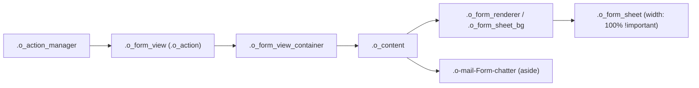

# Sovereign Dual-Theme & Form Architecture (`insilos_theme_genesis`)

Technical reference for the Insilos Enterprise 20 Dual-Theme Token Architecture, Asset Bundle Segregation, Full-Width Form Layout, Dual-Theme Launcher Icon Guard, and Modal Footer Deduplication.

---

## 1. System Architecture & Asset Bundle Lifecycle

Insilos 20 compiles backend stylesheets into two distinct bundles depending on the active `color_scheme` cookie (`light` vs `dark`):
- **Light Mode (`color_scheme=light`)**: Loads `web.assets_backend` (`web.assets_web.min.css`).
- **Dark Mode (`color_scheme=dark`)**: Loads `web.assets_backend` + `web.assets_web_dark` (`web.assets_web_dark.min.css`).

```mermaid
flowchart TD
    A["HTTP Request /web"] --> B{"Cookie: color_scheme"}
    B -->|"light (default)"| C["Load web.assets_web.min.css"]
    B -->|"dark"| D["Load web.assets_web_dark.min.css"]
    C --> E["Light Tokens: :root, .o_web_client (--insilos-bg-surface: #FFFFFF)"]
    D --> F["Dark Overrides: :root, body.o_dark_mode (--insilos-bg-surface: #0F172A)"]
    E --> G["Render Single Light Launcher Logo + 100% Width Form Sheet"]
    F --> H["Render Single Dark Launcher Logo + Zero Bare White Surfaces"]
```



### 1.1 Anti-Leakage Manifest Pattern
Never use wildcard globs (`static/src/**/*`) in `web.assets_backend` when `.dark.scss` files exist in the same directory tree. Wildcard globs pull `.dark.scss` into the light bundle, turning Light Mode surfaces pitch-black.

**Correct `__manifest__.py` Pattern** ([`enterprise/insilos_logistics_idp/__manifest__.py`](file:///home/zen/O20/enterprise/insilos_logistics_idp/__manifest__.py#L31-L46), [`enterprise/insilos_market_terminal/__manifest__.py`](file:///home/zen/O20/enterprise/insilos_market_terminal/__manifest__.py#L29-L43)):
```python
'assets': {
    'web.assets_backend': [
        'insilos_logistics_idp/static/src/dashboard/dashboard.js',
        'insilos_logistics_idp/static/src/dashboard/dashboard.xml',
        'insilos_logistics_idp/static/src/dashboard/dashboard.scss',
    ],
    'web.assets_web_dark': [
        'insilos_logistics_idp/static/src/dashboard/dashboard.dark.scss',
    ],
}
```

> **Warning**: Never add `('remove', 'path/to/file.dark.scss')` in `web.assets_backend` if that file was not explicitly added to `web.assets_backend` first—the asset bundler raises `ValueError: File(s) [...] not found in bundle web.assets_backend`.

---

## 2. Dual-Theme Navbar Launcher Icon Guard

To prevent both Light and Dark SVG icons from rendering simultaneously in the top-left App Launcher ([`enterprise/web_enterprise/static/src/webclient/navbar/navbar.xml`](file:///home/zen/O20/enterprise/web_enterprise/static/src/webclient/navbar/navbar.xml#L24-L47)):

1. **Inline XML Default Guard**: The dark icon (`img.o_insilos_launcher_icon_dark`) carries `style="height: 22px; width: auto; object-fit: contain; display: none;"` directly in QWeb XML so that even before CSS evaluation or in light mode, only the light icon renders.
2. **Light Mode SCSS** ([`insilos_systray_restructure.scss`](file:///home/zen/O20/enterprise/insilos_theme_genesis/static/src/scss/insilos_systray_restructure.scss#L76-L85)):
   ```scss
   .o_insilos_launcher_icon_light {
     display: inline-block !important;
   }
   .o_insilos_launcher_icon_dark {
     display: none !important;
   }
   ```
3. **Dark Mode SCSS** ([`insilos_webclient_general.dark.scss`](file:///home/zen/O20/enterprise/insilos_theme_genesis/static/src/scss/insilos_webclient_general.dark.scss#L261-L268)):
   ```scss
   .o_navbar_apps_menu {
     .o_insilos_launcher_icon_light {
       display: none !important;
     }
     .o_insilos_launcher_icon_dark {
       display: inline-block !important;
     }
   }
   ```

---

## 3. Insilos 20 Form & Notebook DOM Hierarchy

### 3.1 100% Full-Width Form Sheet
In Insilos 20 WebClient, `.o_form_view` is the root `.o_action` container, and `.o_content` is a child inside `.o_form_view`:



Selectors targeting `.o_content > .o_form_view` will fail to match. Always target `.o_form_view .o_form_sheet_bg > .o_form_sheet` ([`insilos_form_restructure.scss`](file:///home/zen/O20/enterprise/insilos_theme_genesis/static/src/scss/insilos_form_restructure.scss#L88-L130)) to override `addons/mail/static/src/views/web/form/form_renderer.scss`'s `max-width: map-get($container-max-widths, xl)` (`1140px`).

### 3.2 Zero Bare White Surfaces on Form Notebook Tabs
Core `addons/web/static/src/core/notebook/notebook.scss` sets `.o_notebook .nav { background-color: $o-view-background-color; }` (`#ffffff`), while `enterprise/web_enterprise/static/src/core/notebook/notebook.dark.scss` only styles `.nav-link` and omits `.nav`.
To eliminate bare `#ffffff` strips in Dark Mode, both [`insilos_form_restructure.scss`](file:///home/zen/O20/enterprise/insilos_theme_genesis/static/src/scss/insilos_form_restructure.scss#L384-L390) and [`insilos_webclient_general.dark.scss`](file:///home/zen/O20/enterprise/insilos_theme_genesis/static/src/scss/insilos_webclient_general.dark.scss#L140-L152) enforce:
```scss
.o_notebook {
  .nav,
  .nav-tabs,
  .o_notebook_headers {
    background-color: transparent !important;
  }
}
```

---

## 4. Dialog & Modal Footer Deduplication

- **FormViewDialog (`act_window` modals)**: When an architecture defines a custom `<footer>`, [`FormRenderer`](file:///home/zen/O20/addons/web/static/src/views/form/form_renderer.xml#L18-L21) suppresses `FormStatusBar` action buttons (`!props.footerArchInfo`), and [`Dialog`](file:///home/zen/O20/addons/web/static/src/core/dialog/dialog.xml#L35-L37) suppresses the default "Ok" fallback button whenever a custom `footer` slot is present.
- **Duplicate Close Button Removal**: In views that already render a primary dismiss button (`special="cancel"`), redundant secondary close buttons are omitted (e.g. [`base_module_uninstall_views.xml`](file:///home/zen/O20/insilos/addons/base/views/base_module_uninstall_views.xml), [`pay_wizard_views.xml`](file:///home/zen/O20/addons/account/wizard/pay_wizard_views.xml)).

---

## 5. Verification & Multi-Pod Synchronization

### 5.1 Local Dual-Theme Playwright Audit
Run against `http://localhost:28069` (PostgreSQL port `5434`, database `insilos20_dev`):
```bash
node tools/audit_crm_dual_theme.js
```
Verifies:
- `visibleCount === 1` for `.o_navbar_apps_menu img` in both Light and Dark modes.
- `sheetWidth > 950px` (1046px full-width form sheet alongside Chatter).
- `bareWhiteCount === 0` across all visible elements inside `.o_form_view` in Dark Mode.

### 5.2 Production Multi-Pod Sync (`innoria.com` / `innoria.insilos.com`)
Synchronizes modified files to all 5 production pods (`innoria-prod-app` + `insilos-saas-app`), clears stale `ir_attachment` bundles, pre-warms assets, and sends `SIGHUP` to workers:
```bash
python3 tools/sync_all_pods_and_reload.py --apply
```
